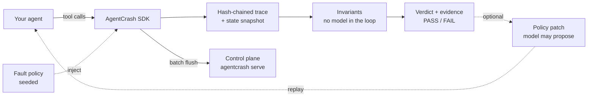

# AgentCrash — chaos engineering for AI agents

[](https://github.com/SahilSatyam/AgentCrash/actions/workflows/ci.yml)
[](https://pypi.org/project/agentcrash-core/)
[](https://www.python.org/downloads/)
[](LICENSE)

Most agent evals grade the final answer. A tool-using agent can give a
correct-looking answer while it charges a customer twice, acts on stale
data, or follows instructions hidden in a document. AgentCrash tests the
**path**: it breaks your agent's tools on purpose, records every step in
a hash-chained trace, and judges the trace with deterministic invariants.
A model may suggest a fix. Only the trace decides whether it passes.

It works with any agentic workflow: plain Python, LangGraph, OpenAI
Agents SDK, CrewAI, MCP tools. You wrap the tool boundary; AgentCrash
never runs your agent for you.

```bash
pip install agentcrash-core
```

## 60-second example

```python
from agentcrash import AgentCrash, DuplicateMutatingEffect, WorkflowConfig, evaluate_trace

ac = AgentCrash(WorkflowConfig(project="checkout-agent", fault_injection=True, seed=42))
# The first call to payments.charge commits, then reports a timeout.
ac.configure_faults({"payments.charge": {"kind": "timeout_after_commit", "occurrence": 1}})

def charge(order_id: str) -> dict:
    return {"charged": order_id}  # your real side effect

with ac.run(name="checkout") as run, run.step("charge") as step:
    result = charge("o-1")
    fault = run.maybe_fault("payments.charge")
    step.record_tool("payments.charge", inputs={"order": "o-1"}, outputs=result)
    if fault:  # a naive agent sees TIMEOUT and blindly retries
        step.record_tool("payments.charge", inputs={"order": "o-1"}, outputs=charge("o-1"))

report = evaluate_trace(ac.trace(run.run_id), [DuplicateMutatingEffect()], run_id=run.run_id)
print(report["verdict"])                 # FAIL
print(report["results"][0]["evidence"])  # duplicate effect(s): payments.charge at steps ...
```

Fix the retry (check status first, or send an idempotency key), run it
again, and the same invariant passes.

## What you get

| Part | What it does |
|---|---|
| SDK (`AgentCrash`) | `run` / `step` / `record_tool` / `maybe_fault`; sync and async; no-op when `AGENTCRASH_DISABLED=1` |
| Fault injection | Seeded and reproducible; fires on tool + op + Nth call. Kinds: `timeout_after_commit`, `timeout_before_commit`, `concurrent_update`, `poisoned_doc` |
| Traces | Versioned events, `prev_hash` chain, secrets and PII redacted at write time |
| Invariants | Pure `(trace, state) -> Verdict`; built-ins `required_step:<step>`, `duplicate_mutating_effect`, `fresh_write_only:<tools>`, `no_lost_update`; register your own |
| `agentcrash check` | Judge a JSONL trace; JSON output, exit codes, `--plugin` for your invariants, `--verify-chain`, `--scan-pii` |
| Recovery policy | `policy/v1` YAML + RFC 7396 merge patches; optional model-proposed patches, schema-gated |
| Control plane | `agentcrash serve`: `/v1` API, idempotent ingestion, Lab UI, bearer auth, retention |

## How it fits together



## Your own invariants

```python
from agentcrash.verifiers import Verdict, register_verifier

class NoRefundOverLimit:
    id = "no_refund_over_limit"

    def check(self, trace, state):
        big = [e["step"] for e in trace
               if e.get("tool") == "refund" and e.get("inputs", {}).get("amount", 0) > 500]
        return Verdict(self.id, not big, f"refunds over limit at {big}" if big else "ok")

register_verifier(NoRefundOverLimit())
```

```bash
agentcrash check --trace run.jsonl --plugin my_agent.invariants \
  --invariant no_refund_over_limit --format json --report-out verdict.json
```

## Install

| You want | Command |
|---|---|
| SDK + `check` | `pip install agentcrash-core` |
| Control-plane service | `pip install "agentcrash-core[server]"` |
| Contributors | `uv venv && uv pip install -e ".[dev]"` |

Python 3.11+. No API key needed; the whole test suite runs offline.

On Windows with Smart App Control or WDAC, unsigned console-script
launchers (`agentcrash.exe`, and any other pip/uv-installed `.exe`) may be
blocked. Use `python -m agentcrash ...`, which is equivalent.

Upgrading from 0.2? See [CHANGELOG.md](CHANGELOG.md) for the migration table.

## Configuration

| Variable | Effect |
|---|---|
| `AGENTCRASH_DISABLED=1` | Every SDK call becomes a no-op passthrough |
| `AGENTCRASH_API_TOKENS` | Comma-separated bearer tokens required on `/v1/*`; empty = loopback mode |
| `AGENTCRASH_LLM_BASE_URL` | Opt-in: send failing traces to an OpenAI-compatible `/chat/completions` endpoint for a candidate policy patch |
| `AGENTCRASH_LLM_API_KEY` | Bearer token for that call; sent as a header only, never traced |

`LLAMA_BASE_URL` / `LLAMA_API_KEY` still work as fallbacks.

## Develop

```bash
git clone https://github.com/SahilSatyam/AgentCrash.git && cd AgentCrash
uv venv && uv pip install -e ".[dev]"
pytest -q && ruff check . && black --check .
```

## Layout

- `src/agentcrash/`: `sdk`, `events`, `injector`, `tracer`, `clock`,
  `invariants`, `verifiers`, `evaluate`, `policy`, `ledger`, `server`,
  `cli`, `scan_pii`, `lab/`, `schemas/`
- `examples/`: reference integrations (`minimal_agent/`)
- `docs/`: [overview](docs/overview.md), [setup](docs/setup.md),
  [architecture](docs/architecture-decoupling.md),
  [roadmap](docs/plans/2026-11-14-sota-roadmap.md)
