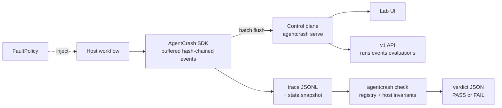
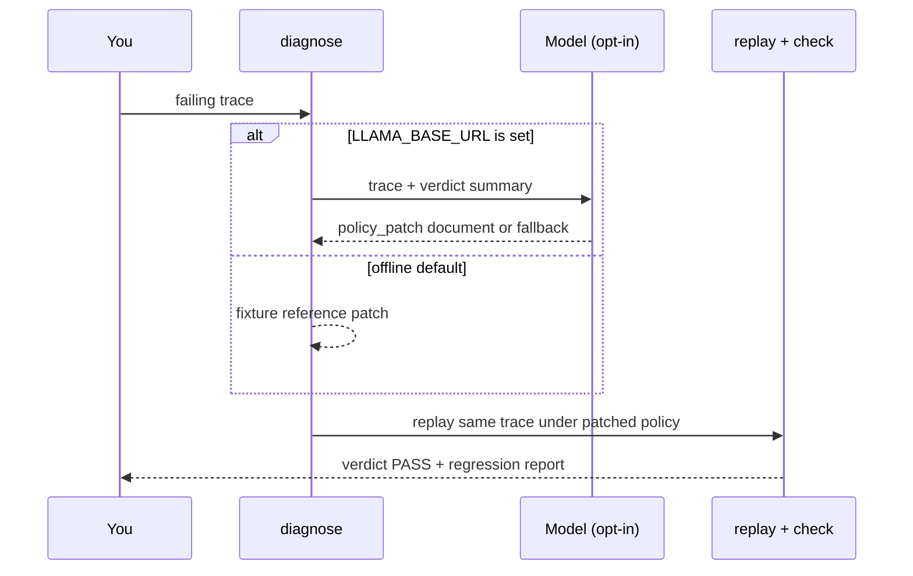

# AgentCrash — reliability framework for agentic workflows

[](https://github.com/SahilSatyam/AgentCrash/actions/workflows/ci.yml)
[](https://pypi.org/project/agentcrash-core/)
[](https://www.python.org/downloads/)

Your agents already do the work. AgentCrash makes them **prove it** — SDK
instrumentation, hash-chained event traces, deterministic fault
injection, and a fail-closed verifier that judges every run against
recorded evidence. The model can suggest a fix; only the trace decides
whether it passes.

```bash
pip install agentcrash-core
```

```python
from agentcrash import AgentCrash, WorkflowConfig

ac = AgentCrash(WorkflowConfig(project="my-workflow", fault_injection=True))

with ac.run(name="my-run") as run:
    with run.step("my-step"):
        ...  # your business logic — AgentCrash never orchestrates it
```

```bash
agentcrash check --trace run.jsonl --invariant required_step:my-step \
  --report-out verdict.json
# verdict.json: PASS or FAIL, with the evidence cited
```

## Why AgentCrash

- **Verification, not vibes.** Every run emits a versioned event
  trace. `check` replays registry invariants against that trace —
  no LLM-as-judge, no flaky assertions.
- **Never owns your workflow.** The SDK observes: buffered export,
  bounded memory, network failures swallowed and counted. Your code
  keeps working with the framework installed, disabled
  (`AGENTCRASH_DISABLED=1`), or absent.
- **Breaks things on purpose.** Fault policies inject timeouts,
  poisoned reads, and concurrent writes so your retry and reconcile
  logic is tested — not hoped for.
- **Diagnose → patch → replay.** A failing trace maps to a
  reference policy patch (fixture-backed, or model-proposed when you
  opt in); replay the same trace under the patch and watch it pass.

## How it fits together



Core owns the framework (SDK, events, invariants, faults, server).
Domain logic lives in host packages, which register their own
invariants — e.g. the NL-to-ODRL agent in
[`nl2odrl-responsible-ai`](https://github.com/SahilSatyam/nl2odrl-responsible-ai)
adds `odrl_valid`, `exactly_once_save`, and `no_attacker_grant`
alongside the generic checks (`required_step`, `duplicate_mutating_effect`,
`fresh_write_only`, `no_lost_update`). Any agentic workflow can do the same.

## The reliability loop



## Install

| You want | Command |
|---|---|
| SDK + control-plane client | `pip install agentcrash-core` |
| Control-plane service (`serve`) | `pip install "agentcrash-core[server]"` |
| Host-domain helpers (SHACL, DSPy, numpy) | `pip install "agentcrash-core[host-odrl]"` |
| Contributors | `uv venv && uv pip install -e ".[dev]"` |

Requirements: Python 3.11+, no API key for anything below (44-test
suite runs fully offline).

## Use it

**Judge a trace** — verify registry invariants against an SDK-schema
JSONL trace, optionally with host plugins, state snapshot, and a PII
leak scan:

```bash
agentcrash check --trace run.jsonl --state run.state.json \
  --plugin my_agent.verifiers --invariant required_step:fetch \
  --report-out verdict.json --format json --scan-pii
```

**Run the control plane** (Lab UI + `/v1` API, local only):

```bash
agentcrash serve --port 8901
```

| Endpoint | Method | Purpose |
|---|---|---|
| `/v1/projects` | POST | register a project |
| `/v1/events` | POST | ingest versioned events (idempotent on `event_id`) |
| `/v1/runs`, `/v1/runs/{id}` | GET | list / inspect runs |
| `/v1/evaluations` | POST | submit an evaluation |
| `/v1/runs/{id}/evaluation` | GET | read a run evaluation |
| `/v1/admin/prune` | POST | prune retained runs |

## Configuration

| Variable | Effect |
|---|---|
| `AGENTCRASH_DISABLED=1` | Every SDK call becomes a no-op passthrough |
| `AGENTCRASH_API_TOKENS` | Comma-separated bearer tokens required on every `/v1/*` call; empty (default) = loopback mode, all local traffic accepted |
| `LLAMA_BASE_URL` | Opt-in live diagnosis: failing traces are sent to an OpenAI-compatible `{base}/chat/completions` endpoint for a candidate patch; unset = fixture fallback |
| `LLAMA_API_KEY` | Bearer header for the live call above — header only, never logged or traced |

## Develop

```bash
git clone https://github.com/SahilSatyam/AgentCrash.git && cd AgentCrash
uv venv && uv pip install -e ".[dev]"
pytest -q   # 44 tests, offline
```

## Layout

- `src/agentcrash/` — `sdk`, `events`, `invariants`, `evaluate`,
  `server`, `verifiers` (registry + generic checks), `tracer`,
  `clock`, `injector`, `ledger`, `policy`, `scan_pii`, `db`,
  `lab/` (control-plane UI assets), `schemas/` (bundled policy schemas)
- `examples/minimal_agent/` — second-app sample with zero domain imports
- `examples/README.md` — writing your own host
- `docs/` — start with
  [`docs/architecture-decoupling.md`](docs/architecture-decoupling.md),
  which defines the core/host boundary
