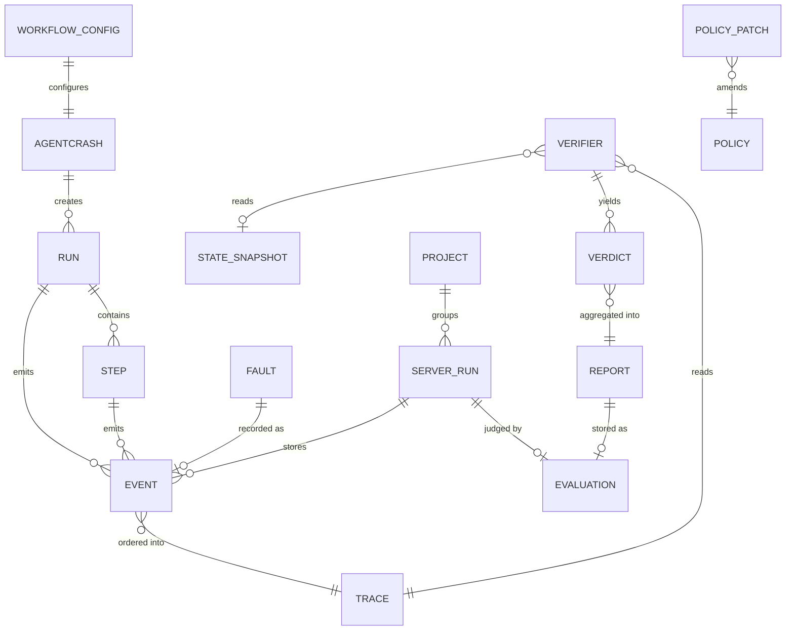

# 04 — Glossary and Domain Model

**Status:** Current for `agentcrash-core` 0.3.0 · **Owner:** Founder (scope sign-off) · **Milestone scheme:** M0–M3 (ADR-006)

> ADLC lens: one shared vocabulary so the team, its prompts, its code and its docs never mean
> different things by the same word. Terms below use the names in `src/agentcrash/`. Every
> requirement in [03](03-requirements-and-srs.md) and every target in
> [12](12-non-functional-requirements.md) uses them as defined here. Progress is gated by
> milestone exit criteria, never by calendar days.

## 1. Glossary

The core is domain-free (ADR-009), so every example uses neutral tools: `payments.charge`,
`crm.update`, a `kv` store. Terms for features removed in 0.3.0 (scenario runner, stub agent,
`run` / `diagnose` / `replay` commands, model adapter) are not defined here; see ADR-009.

| # | Term | Definition | Code name / example |
|---|---|---|---|
| 1 | ADLC | The phase-gated lifecycle used to ship AgentCrash: milestones M0–M3 (ADR-006), no calendar gating. | "M1 exit = tests green", not "ships Friday". |
| 2 | Host | The application that owns the agent loop and its tools (plain Python, LangGraph, OpenAI Agents SDK, CrewAI, MCP). AgentCrash never orchestrates it. | A checkout agent that calls `payments.charge`. |
| 3 | Agent under test | The tool-using workflow whose reliability is measured. Part of the host, not of AgentCrash. | A function decorated with `@ac.workflow("checkout")`. |
| 4 | Workflow | One host function or loop instrumented as a run. Named by the `name` passed to `ac.run(name)` or `@ac.workflow(name)`; stored as `workflow` on every event. | `workflow="checkout"`. |
| 5 | SDK | The in-process instrumentation library: `AgentCrash` plus `WorkflowConfig`. Observes, injects, exports; never raises into host code. | `agentcrash.sdk`. |
| 6 | `WorkflowConfig` | Host-supplied SDK settings: `project`, `environment`, `fault_injection`, `enabled`, `endpoint`, `api_key`, `max_queue`, `seed`. | `WorkflowConfig(project="p1", fault_injection=True, seed=7)`. |
| 7 | Project | The name that groups runs on the control plane. Registered with `POST /v1/projects`; set via `WorkflowConfig.project`. | `project="checkout-agent"`. |
| 8 | Run | One execution of a workflow. Identified by `run_id` (`run_<12 hex>` from the SDK). Opened with `ac.run(name)`; `RunContext` is its handle. | `RunContext.run_id`, `ac.trace(run_id)`. |
| 9 | Step | A named phase inside a run, opened with `run.step(name)`. Emits `step_start` and `step_end`. Invariants such as `required_step:<name>` match on step name. | `run.step("charge")`. |
| 10 | Tool call | One recorded tool invocation inside a step, written by `step.record_tool(tool, inputs, outputs, status, error, fault)`. Emits an event with `kind="tool"`. | `record_tool("payments.charge", inputs={"order": "o-1"})`. |
| 11 | Boundary | The named point where a fault may fire, passed to `run.maybe_fault(boundary)`. Usually the tool name. | `maybe_fault("payments.charge")`. |
| 12 | Event | One SDK record under schema v1: `schema_version, event_id, run_id, project, workflow, step, parent_step, kind, status, seq, tool, inputs, outputs, error, fault`, plus `prev_hash` once captured. | `events.make_event`, `events.validate_event`. |
| 13 | Event `kind` | What an event records: `run_start`, `step_start`, `tool`, `fault`, `result`, `step_end`, `run_end`. | `kind="tool"`. |
| 14 | `event_id` | Idempotency key for ingestion: `evt_<run_id>_<seq:04d>` in the SDK. The server dedupes on it. | `evt_run_ab12cd34ef56_0003`. |
| 15 | `seq` | Positive integer ordering of events, assigned under a lock by the SDK instance (one counter per `AgentCrash`, not per run). | `seq=3`. |
| 16 | `prev_hash` | SDK hash-chain link: `sha256(prev_hash + ":" + canonical_json(event))`, starting at `GENESIS`. An integrity signal against accidental loss or reordering. Not tamper-proof; there is no signing in v1. | `event["prev_hash"]`. |
| 17 | Hash chain | The linked `prev_hash` values over a trace. SDK chains use the rule above; `TraceWriter` chains use `sha256` of the previous canonical line. `verify_chain(path)` checks the latter and names the first bad event. | `tracer.verify_chain`. |
| 18 | Trace | The ordered events of a run. In memory: `ac.trace(run_id)`. On disk: a JSONL file, one event per line, which `agentcrash check --trace` reads. | `run.jsonl`. |
| 19 | `TraceWriter` | Standalone JSONL writer for host-produced traces. Envelope fields: `event_id, prev_hash, ts_virtual, run_id, scenario, step, tool, args, outcome, latency, injector_event, policy_decision, detail`; sorted keys; gapless ids; monotonic `ts_virtual`; 64 KB `detail` cap. | `tracer.TraceWriter`. |
| 20 | `ts_virtual` | Host-controlled virtual timestamp in integer ms, monotonic within a trace. Never wall-clock. | `latency` advances it in `TraceWriter`. |
| 21 | `VirtualClock` | The only time source for synthetic tools. Integer ms, starts at 0, advances only via `sleep(ms)`. | `clock.VirtualClock`. |
| 22 | Fault | A deliberate misbehavior injected at a boundary or tool call. Recorded as an event with `kind="fault"` and the descriptor in `fault`. | `{"kind": "timeout_after_commit", "occurrence": 1}`. |
| 23 | Fault catalog | The table of supported fault kinds with description, effect, `inline_supported`, `default_params` and `params_schema`. No kind has a default `tool`. | `injector.FAULT_CATALOG`. |
| 24 | `timeout_after_commit` | Ambiguous timeout. The write commits, then the tool reports TIMEOUT, so the agent cannot tell whether it happened. A blind retry duplicates the side effect. | Catalog kind. |
| 25 | `timeout_before_commit` | Clean timeout. TIMEOUT is reported and nothing commits. Retrying is safe, but blind retries waste work. | Catalog kind. |
| 26 | `concurrent_update` | A rival writer lands first. Requires `key` and `updates`; a blind write loses the rival's fields. | Catalog kind; `validate_fault_entry` refuses it without both params. |
| 27 | `poisoned_doc` | Inert marker for an injected instruction inside a fixture document. The fixture bytes carry the injection; the kind itself changes nothing at run time. | Catalog kind with `inline_supported: false`. |
| 28 | Trigger | The rule that decides when a fault fires. SDK: `occurrence` (Nth call of a boundary within a run). `FaultSchedule`: `tool` / `op` / `occurrence` (Nth matching call), or `at_step` (1-based loop step). Call-count triggers are preferred. | `FaultSchedule.fault_for_call`, `FaultPolicy.should_fire`. |
| 29 | `FaultPolicy` / `FaultSchedule` | `FaultPolicy` is the SDK's boundary-to-descriptor map set by `configure_faults`. `FaultSchedule` is the declarative schedule that refuses unknown kinds (`UnknownFaultError`). Distinct from a recovery Policy (term 40). | `sdk.FaultPolicy`, `injector.FaultSchedule`. |
| 30 | Fault injection flag | `WorkflowConfig.fault_injection`. Faults fire only when it is true and the SDK is enabled. | Default `False`. |
| 31 | Disabled mode | `AGENTCRASH_DISABLED=1` or `enabled=False`. Every SDK call is a no-op passthrough. | `AgentCrash._active()`. |
| 32 | Export queue | Bounded in-memory buffer (`max_queue`, default 1000). Drops the oldest event when full and counts drops. Batches of 50 flush to `{endpoint}/v1/events`; failures are counted and never raised. | `sdk._Exporter`, `exporter.dropped`, `exporter.failed`. |
| 33 | At-least-once delivery | The SDK may send an event more than once; the server stores each `event_id` once. | `ingest_events` returns `accepted` / `duplicate` / `invalid`. |
| 34 | Redaction | Write-time masking of caller-supplied fields. Keys matching `*_token`, `*secret*`, `*key*` (except `idempotency_key`) become `[REDACTED]`; emails become `redacted@example.com`; card-like digit runs become `4111111111111111`. Harness-owned fields are never redacted. | `tracer.redact`. |
| 35 | PII scan | Offline check that finds raw emails and card-like runs in a trace or state file. Redaction placeholders are exempt. Enabled by `check --scan-pii`; a hit exits 1. | `scan_pii.scan_files`. |
| 36 | Invariant | A deterministic predicate over `(trace, state)` identified by a string id. Fails closed: bad input is an error, never a pass. | `duplicate_mutating_effect`, `required_step:<name>`, `fresh_write_only`, `no_lost_update`. |
| 37 | Verifier | An object with `id` and `check(trace, state) -> Verdict`. Pure: no network, clock or model. Registered with `register_verifier`; hosts add their own through `check --plugin`. | `_registry.Verifier`, `RequiredStep`, `DuplicateMutatingEffect`, `FreshWriteOnly`, `NoLostUpdate`. |
| 38 | Verdict / report | A `Verdict` is `(invariant_id, passed, evidence)`. A report is `{api_version, run_id, verdict: PASS|FAIL, results: [{id, passed, evidence}]}`, written by `check` to `--report-out`. `compare_reports` diffs two reports into `regressions` and `fixes`. | `_registry.Verdict`, `evaluate.compare_reports`. |
| 39 | State snapshot | Optional JSON object passed to `check --state`; the second input of every verifier. `NoLostUpdate` reads `record_versions` from it. | `Ledger.snapshot(run_id)`. |
| 40 | Policy | A recovery policy document, `schema_version: policy/v1`: a list of rules with `rule` (`on_tool_timeout`, `on_mutating_retry`, `on_untrusted_content`, `on_stale_read`), `tool`, `action` (`fail`, `retry_same`, `check_then_act`, `require_confirmation`), optional `retry` (`max_attempts` 0–3, `require_idempotency_key`). | `policy.load_policy`, `schemas/policy.json`. |
| 41 | Policy patch | A `policy_patch/v1` JSON document (`source_run_id`, `rationale`, `patch`) whose `patch` is an RFC 7396 JSON Merge Patch. Proposed by a model or a human; validated against `schemas/policy-patch.json` before use. | `policy.apply_patch`, `PolicyRejectedError`. |
| 42 | Live patch | The opt-in proposal path: `fetch_live_patch` asks any OpenAI-compatible `/chat/completions` endpoint when `AGENTCRASH_LLM_BASE_URL` is set. The model proposes only; the result must pass patch validation. | `policy.fetch_live_patch`. |
| 43 | Ledger | Synthetic versioned key-value store used as a test double: records start at version 1, fresh writes bump it, stale writes commit but flag `version_conflict`. | `ledger.Ledger`, `ledger_hash`. |
| 44 | Idempotency key | Client-generated token that makes a retried mutating call dedupe to one effect. Never redacted. | `args["idempotency_key"]`. |
| 45 | Control plane | The `/v1` HTTP service that ingests events and serves runs, evaluations and reliability counts. In-memory store; stdlib loopback server, or the FastAPI app from `create_fastapi_app()`. | `server.serve()`, `agentcrash serve`. |
| 46 | Lab | The static UI served by the control plane at `/` and `/lab`. | `src/agentcrash/lab/`. |
| 47 | API token | Entry in `AGENTCRASH_API_TOKENS`. When the list is non-empty every `/v1/*` call needs `Authorization: Bearer <token>`; unset means loopback mode. | `_allowed_bearers()`. |
| 48 | Retention (prune) | Control-plane cleanup: keep the last N runs and/or drop runs older than D days, per project. | `prune_runs`, `POST /v1/admin/prune`. |
| 49 | Exit code | `check` contract: `0` PASS, `1` FAIL or PII leak, `2` usage/config (`E_CONFIG`), `3` corrupt trace (`E_TRACE_CORRUPT`). Codes `4` (policy rejected) and `5` (run aborted) are reserved for host CLIs. | `cli.EXIT_*`. |
| 50 | Plugin | A dotted module imported by `check --plugin` before judging, so it can register host invariants. | `--plugin my_agent.invariants`. |
| 51 | Domain-free core | ADR-009 rule: no domain vocabulary or baked-in tool target in `src/`. Enforced by a guard test. | `tests/test_generic_core.py`. |
| 52 | Determinism rule (ACR001) | Deterministic modules import no `time`, `datetime` or `random`. Enforced by an AST test. | `tests/test_acr001.py`. |
| 53 | Milestone (M0–M3) | Repo-wide gate scheme from ADR-006. Future work maps to roadmap items R1–R7. | `docs/plans/2026-11-14-sota-roadmap.md`. |
| 54 | Roadmap item (R1–R7) | R1 framework adapters, R2 fault catalog v2, R3 invariant library v2, R4 reliability metrics, R5 standard traces, R6 generic diagnose and replay, R7 release hygiene. | Roadmap §3. |

## 2. Synonyms and ambiguous terms (do-not-use list)

| Avoid | Use instead | Why |
|---|---|---|
| "Test" (bare) | Run, invariant, or verdict | "Test" blurs the execution, the check and the verdict. |
| "Policy" (bare) | Policy (`policy/v1`) or Fault policy (`FaultPolicy`) or Policy patch | Three different objects share the word. |
| "Retry" (bare) | Blind retry vs retry with an idempotency key | The distinction is what the duplicate-effect invariant measures. |
| "Key" (bare) | Idempotency key vs API key | Opposite handling: one is kept in traces, the other is redacted. |
| "Scenario" for new work | Workflow, fault, invariant | `scenario.yaml` runners were removed in 0.3.0. `TraceWriter` still has a `scenario` envelope field; treat it as a label. |
| "Replay" / "diagnose" (as shipped commands) | Roadmap R6 | No such command exists in 0.3.0. |
| "Tamper-proof" for the hash chain | Integrity signal | There is no signing in v1. |
| "Passed" (of the agent) | Verdict PASS for the named invariants | A run passes only the invariants that were requested. |

## 3. Domain model

### 3.1 Entities

| Entity | Meaning | Key attributes | Relationships |
|---|---|---|---|
| WorkflowConfig | SDK settings | `project`, `environment`, `fault_injection`, `enabled`, `endpoint`, `api_key`, `max_queue`, `seed` | Owned by one `AgentCrash` |
| AgentCrash | SDK instance | `faults`, `exporter`, `traces`, `_seq`, `_prev_hash` | Creates many Runs; one hash chain per instance |
| Run (`RunContext`) | One workflow execution | `run_id`, `name`, `faults_fired` | Belongs to one AgentCrash; has many Steps and Events |
| Step | Named phase in a run | `name` | Emits `step_start`, `tool`, `step_end` events |
| Event | SDK v1 record | `event_id`, `seq`, `kind`, `status`, `tool`, `inputs`, `outputs`, `error`, `fault`, `prev_hash` | Belongs to one Run; ingested once per `event_id` |
| Fault | Injected misbehavior | `kind`, `occurrence`, `tool`, `op`, `at_step`, params | Chosen by FaultPolicy or FaultSchedule; recorded as a `fault` event |
| FaultPolicy / FaultSchedule | Fault trigger tables | boundary map; `faults[]` | Read at `maybe_fault` or by a host runner |
| TraceWriter event | Envelope line in a JSONL trace | `event_id`, `prev_hash`, `ts_virtual`, `step`, `tool`, `args`, `outcome`, `detail` | Verified by `verify_chain` |
| Invariant / Verifier | Predicate and its implementation | `id`, `check(trace, state)` | Registered in the registry; evaluated by `run_verifiers` |
| Verdict | One judgement | `invariant_id`, `passed`, `evidence` | Aggregated into a Report |
| Report | PASS/FAIL summary | `run_id`, `verdict`, `results[]` | Written by `check`; stored by `/v1/evaluations`; diffed by `compare_reports` |
| Policy | `policy/v1` document | `rules[]` | Amended only through a Policy patch |
| Policy patch | `policy_patch/v1` document | `source_run_id`, `rationale`, `patch` | Validated, then merged by `apply_patch` |
| Ledger | Synthetic versioned store | record versions, `version_conflict` | Produces the State snapshot |
| Project (server) | Group of runs | `project`, `environment`, `runs` | Has many server Runs; target of prune |
| Run (server) | Ingested run | `run_id`, `project`, `workflow`, `events[]`, `created_at` | Holds events in `seq` order; has at most one Evaluation set |
| Evaluation | Stored verdicts for a run | `{id, passed, evidence}` per invariant id | Idempotent per invariant id |

### 3.2 Relationship sketch

AgentCrash 1──creates──▶ Run; Run 1──has-many──▶ Step and Event; Fault fires at a Boundary and
is recorded as an Event; a Trace is the ordered Events of a Run. Verifiers read `(Trace, State
snapshot)` and yield Verdicts; Verdicts form a Report. The control plane ingests Events into a
server Run under a Project and stores the Report as an Evaluation. A Policy patch amends a
Policy; it never changes a Verdict.

### 3.3 Diagram

### 3.4 Naming rules

- Code identifiers use the term in `snake_case` (`event_id`, `prev_hash`, `max_queue`); CLI flags use kebab-case (`--report-out`, `--scan-pii`).
- Invariant ids are lowercase `snake_case`; parametric ids use `name:argument` (`required_step:charge`).
- Event `kind` values are the §1 names (`run_start`, `tool`, `fault`). Adding a kind means adding a glossary row and a schema review.
- Never invent a second word for a defined term; record candidate synonyms in §2 first.

## 4. Worked example: a duplicate charge in glossary terms

A host runs the Workflow `checkout` with `WorkflowConfig(project="checkout-agent",
fault_injection=True)` and calls `ac.configure_faults({"payments.charge": {"kind":
"timeout_after_commit", "occurrence": 1}})`. Inside the Step `charge` it records a Tool call
to `payments.charge`. `run.maybe_fault("payments.charge")` returns the Fault descriptor and
the SDK records a `fault` Event. The agent cannot tell whether the charge committed, so it
retries blindly and records a second `payments.charge` Tool call with the same inputs.

The SDK hash-chains each Event and redacts any `api_key` input. The host writes the Trace to
`run.jsonl` and runs `agentcrash check --trace run.jsonl --invariant duplicate_mutating_effect
--invariant required_step:charge`. `required_step:charge` yields a PASS Verdict (the Step ran).
`duplicate_mutating_effect` yields a FAIL Verdict with evidence naming both steps. The Report
verdict is FAIL and the exit code is 1. The host posts the Events to `/v1/events` (deduped on
`event_id`) and the Report to `/v1/evaluations`; the Lab shows the run under the Project.

A model may then propose a Policy patch that sets `retry.require_idempotency_key` for
`payments.charge`. The patch is validated against `policy_patch/v1` and merged with
`apply_patch`. It does not change the verdict; a rerun of the host workflow and `check` does.
Rerunning through a core command is roadmap R6.

## 5. Change history

| Milestone | Change | Author |
|---|---|---|
| Pre-M0 draft | Glossary skeleton with one placeholder term | Pre-M0 skeleton (author unrecorded) |
| M0 draft | 36 terms for the scenario-runner prototype | Group B |
| 0.3.0 rewrite | 54 terms renamed to match code; removed-feature terms dropped (ADR-009); domain model rebuilt around SDK, events, verifiers, policy and control plane | Docs rewrite |
