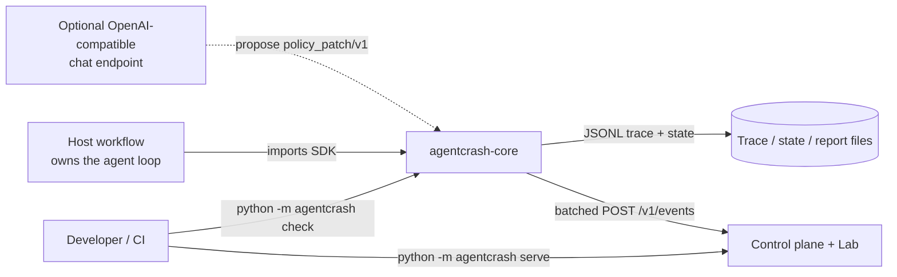
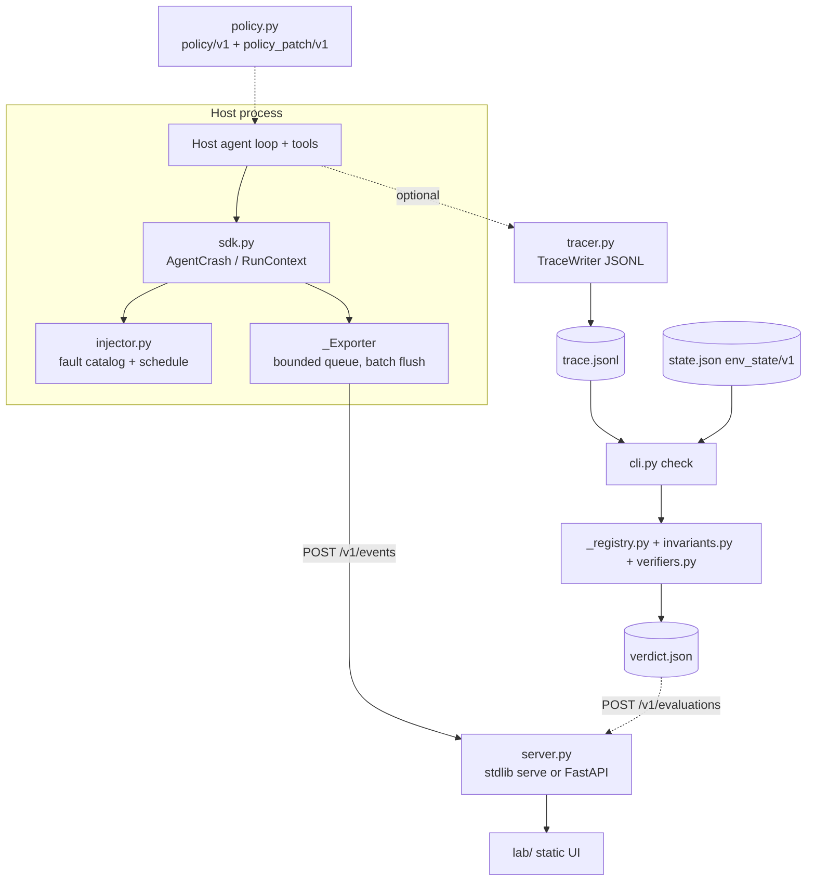
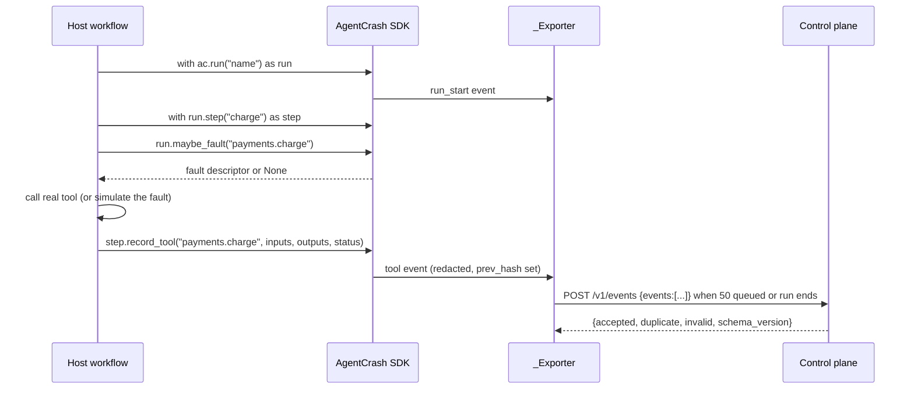
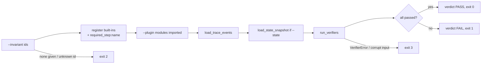
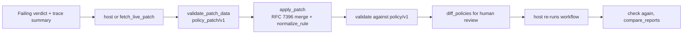

# 05 -- System design and architecture (AgentCrash)

**Status:** Draft -- **Owner:** Startup CTO (interim) -- **Last reviewed:** Phase-gated (no calendar date)
**Describes:** `agentcrash-core` 0.3.0 (import `agentcrash`, MIT, Python 3.11+, deps `pyyaml` and `jsonschema`; extras `server`, `dev`).
**Gate:** Approved only when docs 01-04 are Approved. Milestones follow ADR-006 (M0-M3); future work is tracked as roadmap items R1-R7 in `docs/plans/2026-11-14-sota-roadmap.md`. No day-wise timeline is used.

## 1. Startup lens

AgentCrash is chaos engineering for tool-using AI agents. It answers one question: **can agent reliability at tool boundaries be measured with evidence a skeptic can inspect?** The architecture serves that with three rules.

1. **The host owns the agent loop.** AgentCrash observes, injects faults at tool boundaries the host names, and judges the resulting trace. It never orchestrates the agent.
2. **Deterministic invariants own verdicts** (ADR-001). A model may only propose a policy patch, and the patch is schema-gated and re-judged by the same invariants.
3. **The core is domain-free** (ADR-009). Domain invariants live in the host or a plugin package. `tests/test_generic_core.py` fails if domain vocabulary enters `src/`.

| Startup concern | How the architecture answers it |
|---|---|
| Problem | Agents fail silently at tool boundaries (ambiguous timeouts, concurrent updates, untrusted content). Final-answer evals miss this. |
| Users | Teams building tool-using agents in plain Python, LangGraph, OpenAI Agents SDK, CrewAI or MCP. |
| Cost | Local-first. One pip install, no database, no required service. The control plane is optional. |
| Evidence | JSONL trace plus a deterministic verdict JSON. Never "the model says it passed". |
| Main risks | Flaky judging (kills trust), model-judged verdicts, scope creep into a general eval platform. |

Removed in 0.3.0 (ADR-009, CHANGELOG): the bundled `run`, `diagnose` and `replay` commands, the scenario runner, golden suite and demo domain tools. Host-supplied runners for diagnose/replay are roadmap item R6.

## 2. C4 context (Level 1)

| External entity | Relationship | Trust boundary |
|---|---|---|
| Host workflow | Calls the SDK around its own agent loop and tools | Trusted code. Its tool results are data, not verdicts. |
| Developer / CI | Runs `check` and `serve` | Trusted operator. A patch is never auto-applied without re-judging. |
| Control plane | Receives events over `/v1` | Loopback by default. Bearer tokens via `AGENTCRASH_API_TOKENS`. |
| Policy model (optional) | Proposes a `policy_patch/v1` through `fetch_live_patch` | Untrusted. Output is a candidate patch that must pass JSON Schema. |
| Trace and state files | Evidence read by `check` | Trusted only as far as `verify_chain` and strict loading allow. The chain detects accidental loss or reordering, not tampering. |

## 3. Components (Level 2)

One installable package, no required network between modules.

| Module | Responsibility |
|---|---|
| `sdk.py` | `AgentCrash`, `WorkflowConfig`, `RunContext`, `FaultPolicy`. Records `run_start`, `step_start`, `tool`, `fault`, `result`, `step_end`, `run_end` events. Hash-chains them. Never raises into host code. `AGENTCRASH_DISABLED=1` makes every call a no-op. |
| `_Exporter` (in `sdk.py`) | Bounded drop-oldest queue (`max_queue`, default 1000, `<=0` means unbounded). Flushes batches of 50 or at run end to `<endpoint>/v1/events`, 2 s timeout. Failures are counted and the batch is requeued best-effort. |
| `events.py` | Event schema v1: `make_event`, `validate_event`. |
| `injector.py` | `FAULT_CATALOG`, `FaultSchedule`, `validate_fault_entry`. Faults name no default tool. Unknown kinds raise `UnknownFaultError`. |
| `tracer.py` | Standalone JSONL `TraceWriter`, `redact`, `verify_chain`, `compute_run_id`. |
| `clock.py` | `VirtualClock`: integer virtual ms, advances only through `sleep`. |
| `_registry.py` | `Verdict`, `Verifier` protocol, `register_verifier`, `get_verifier`, `verifier_ids`, error types. |
| `invariants.py` | `RequiredStep`, `DuplicateMutatingEffect`. |
| `verifiers.py` | `FreshWriteOnly`, `NoLostUpdate`, `run_verifiers`, `load_trace_events`, `load_state_snapshot`. |
| `evaluate.py` | `evaluate_trace`, `compare_reports` (regressions and fixes between two reports). |
| `policy.py` | `policy/v1` loading, `policy_patch/v1` validation, RFC 7396 merge, `diff_policies`, opt-in `fetch_live_patch`. |
| `ledger.py` | `Ledger`: synthetic versioned store for tests. Produces `env_state/v1` snapshots. |
| `scan_pii.py` | Offline raw-PII scan used by `check --scan-pii`. |
| `server.py` | In-memory control plane: stdlib `serve()` and lazy `create_fastapi_app()`. |
| `cli.py` | `check` and `serve` only, plus `--version`. |

## 4. Flows

### 4.1 Host -> SDK -> exporter -> control plane

Steps:

1. `ac.run(name)` allocates `run_id = run_<12 hex>`. Each event is built by `make_event`, redacted at write time, hash-chained, appended to `ac.traces[run_id]`, then enqueued.
2. `maybe_fault(boundary)` returns a descriptor only when `fault_injection=True`, the SDK is enabled, and the boundary's `occurrence` matches. The host decides how to simulate it. A `fault` event is recorded either way it fires.
3. On endpoint failure the batch is counted in `failed` and requeued at the front. With no endpoint, events stay local and `ac.trace(run_id)` returns them.
4. The server dedupes on `event_id`, so at-least-once delivery is safe.

### 4.2 Trace -> check -> verdict

`check` is a pure function of the trace and state files. It reads no network, no wall clock and no model. It writes `reports/<run_id>.verdict.json` unless `--report-out` is set. With `--scan-pii` it then scans the raw trace and state files and returns exit 1 on any hit. See doc 07 for flags and exit codes.

### 4.3 Optional policy patch

- `fetch_live_patch` runs only when `AGENTCRASH_LLM_BASE_URL` is set (token from `AGENTCRASH_LLM_API_KEY`, plus legacy fallback names read in `policy.py`). It calls `<base>/chat/completions` on any OpenAI-compatible server. Transport failure returns `None` so the host can fall back to its own patch.
- A response that is not a valid `policy_patch/v1`, or a merged policy that violates `policy/v1`, raises `PolicyRejectedError` (exit code 4 is reserved for host CLIs). Nothing is silently ignored.
- Re-running the workflow and re-judging is the host's job. The core ships no replay runner (roadmap R6).

## 5. Determinism strategy

| Rule | Where enforced |
|---|---|
| No wall clock, network or model call in judged paths | `verifiers.py`, `invariants.py`, `tracer.py`, `clock.py`. `tests/test_acr001.py` (ACR001 lint) fails on wall-clock reads in guarded modules. |
| Time is virtual integer milliseconds | `VirtualClock`, `ts_virtual` in the tracer envelope. |
| Canonical JSON | `sort_keys=True`, compact separators for trace lines and hashes. |
| Fault firing is call-count based | `occurrence` per boundary (SDK) or tool/op/occurrence or `at_step` (`FaultSchedule`). |
| Verdicts are never model output | `run_verifiers` rejects a verifier that returns a bad `Verdict`. |
| Harness faults are not verdicts | `VerifierError` and `TraceCorruptError` lead to exit 3, never to PASS or FAIL. |

Known gap: `AgentCrash` assigns `run_id` from `uuid4`, so SDK runs are not content-addressed. `compute_run_id(scenario_text, policy_text, seed)` in `tracer.py` serves `TraceWriter` users who want content-derived ids.

## 6. Stack and rationale

| Choice | Reason |
|---|---|
| Python 3.11+, stdlib first | Smallest install. `pyyaml` and `jsonschema` are the only runtime deps. |
| JSONL traces (ADR-002) | Greppable, diffable, appendable, no database. |
| JSON Schema for `policy/v1` and `policy_patch/v1` | Bundled in `src/agentcrash/schemas/`. Gates any model-proposed change. |
| stdlib `HTTPServer` for `serve` | Zero dependencies for loopback use. FastAPI is an optional extra and imported lazily. |
| In-memory control-plane store | Enough for local Lab and tests. Persistence is not implemented. |

## 7. Deployment

- **Library:** `pip install agentcrash-core`. Host imports `agentcrash`.
- **CI:** run `python -m agentcrash check ...` after the host test run. `python -m agentcrash` equals the console script; use it on Windows when Smart App Control blocks the script. CI matrix is Python 3.11-3.13 (`.github/workflows/ci.yml`), plus ruff, black (line length 100) and the offline pytest suite.
- **Control plane:** `python -m agentcrash serve` binds `127.0.0.1:8901` by default. Set `AGENTCRASH_API_TOKENS` before binding anywhere else. Lab static assets stay public.

## 8. Key design decisions

| Decision | Reference |
|---|---|
| Deterministic verdicts, model proposes only | ADR-001 |
| JSONL as single evidence format | ADR-002 |
| Virtual clock instead of wall clock | ADR-003 |
| Policy-file-only patches | ADR-004 |
| Domain-free core, host-named boundaries | ADR-009 |
| Observe-and-inject SDK; host owns the loop | `docs/architecture-decoupling.md` |

## 9. Observability and failure handling

| Failure | Behavior |
|---|---|
| Control plane unreachable | Exporter counts `failed`, requeues, never raises into the host. |
| Queue full | Oldest event dropped, `dropped` counter incremented. |
| Invalid event on ingest | Counted under `invalid`, not stored. |
| Corrupt trace or state | `check` exits 3 with `E_TRACE_CORRUPT`. |
| Unknown invariant, missing file, bad plugin import | `check` exits 2 with `E_CONFIG`. |
| Raw PII in files | `check --scan-pii` exits 1 with `E_PII_LEAK`. |

## 10. Measured performance (NFR-PERF-01)

Source: `bench/run_overhead.py`, `docs/phase7-evidence/bench.json` (30 runs, 12 steps, 2 ms stub step).

| Metric | Measured | Target |
|---|---|---|
| Per-run overhead vs bare loop | 5.7% (25.402 ms vs 24.031 ms median) | <= 10% |
| Overhead per step | ~114 us | n/a |
| SDK cost per event | ~14 us | n/a |
| Tracer cost per event | ~31 us | <= 60 us |
| 100-step trace size | 37,797 bytes | <= 2 MB |

## 11. Roadmap mapping

| Item | Design impact |
|---|---|
| R1 Framework adapters | Thin wrappers over `RunContext`; core stays framework-neutral. |
| R2 Fault catalog v2 | New entries in `FAULT_CATALOG` plus SDK handling. |
| R3 Invariant library v2 | New verifiers registered through `_registry.py`. |
| R4 Reliability metrics | Extends `reliability_summary` and Lab. |
| R5 Standard traces | Export/import mapping from the v1 event schema. |
| R6 Diagnose and replay, generic | Host-supplied runner called by core helpers; model still patch-only. |
| R7 Release hygiene | Packaging, docs and CI before the 0.3.0 upload. |

## 12. Open questions

| # | Question | Owner | Resolves by |
|---|---|---|---|
| 1 | Unify the two hash-chain formats (SDK `sha256("<prev>:<json>")` vs `TraceWriter` `sha256(line)`) or document both permanently | CTO | R5 |
| 2 | Persistent control-plane store (current store is in-memory) | CTO | After R4 |
| 3 | Make `check` accept SDK-event and `TraceWriter` envelopes under one invariant set (today `FreshWriteOnly` and `NoLostUpdate` read the envelope, `DuplicateMutatingEffect` reads SDK events) | CTO | R3 |
