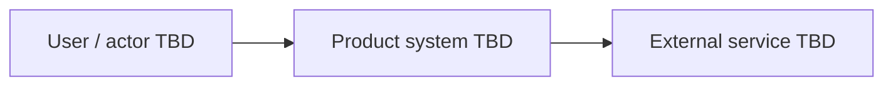

# 05 — System design and architecture overview

**Status:** Draft · **Owner:** TBD · **Last reviewed:** 2026-10-28

This is a design outline, not an approved architecture. Select components only after requirements and feasibility are reviewed.

## Context and boundary

- Users / actors: TBD
- System responsibilities: TBD
- External systems: TBD

## Components and responsibilities

| Component | Responsibility | Technology | Rationale / status |
|---|---|---|---|
| TBD | TBD | TBD | Unselected |

## Main data flows

1. Trigger and actor: TBD
2. Processing and decision points: TBD
3. Data written or returned: TBD
4. Error and recovery behavior: TBD

## Stack and rationale

| Layer | Candidate | Reason | Alternatives / constraints | Decision status |
|---|---|---|---|---|
| Client | TBD | TBD | TBD | Open |
| Service / runtime | TBD | TBD | TBD | Open |
| Storage | TBD | TBD | TBD | Open |
| AI / model services (if applicable) | TBD | TBD | TBD | Open |
| Hosting / deployment | TBD | TBD | TBD | Open |

Record durable choices as individual ADRs using `08-adr-template.md`.

## Integration points

| System / API | Purpose | Data exchanged | Auth / failure behavior | Owner |
|---|---|---|---|---|
| TBD | TBD | TBD | TBD | TBD |

## Environments and deployment topology

- Environments: TBD
- Deployment units and network boundaries: TBD
- Configuration and secrets: TBD
- Rollout and rollback: TBD

## Observability and failure handling

- Logs, metrics, and traces: TBD
- User-visible failures and recovery: TBD
- Alerting and ownership: TBD

## Open design decisions

- TBD
