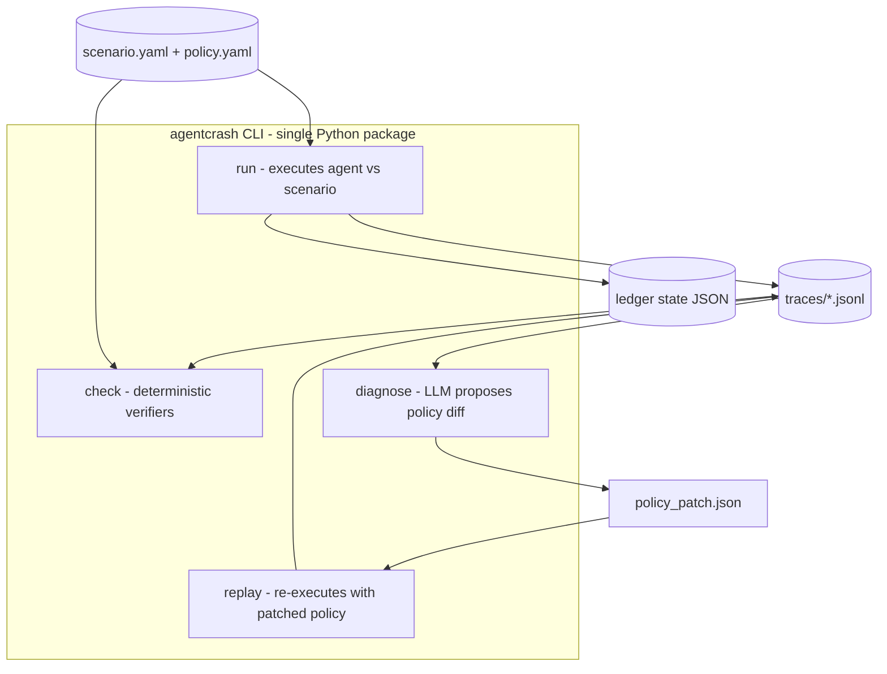
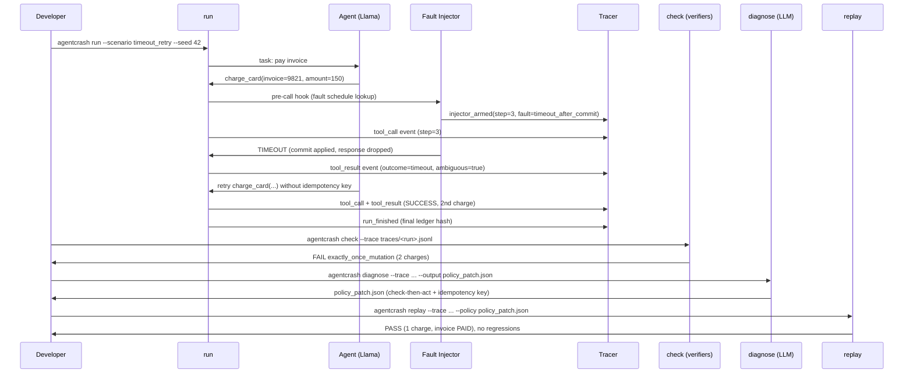

# 05 -- System design and architecture (AgentCrash)

**Status:** Draft -- **Owner:** Startup CTO (interim) -- **Last reviewed:** Phase-gated (no calendar date)
**Gate:** Advances from Draft to Approved only when `01-planning-and-feasibility.md` through `04-glossary-and-domain-model.md` are Approved, and the v0 prototype slice (ambiguous timeout, exactly-once) is frozen. No day-wise timeline is used anywhere in this doc -- only phase/milestone gates.

## 1. Startup lens

AgentCrash is pre-product-market-fit tooling built by a small team to answer one founder-level question: **can we make agent reliability measurable enough that a startup ships tool-using agents without fear of double-charges, leaked instructions, or stale writes?** Every design choice below optimizes for: (a) a demo-able MVP in one prototype phase, (b) near-zero operating cost (local run, one model API), (c) evidence a skeptical early adopter can inspect (JSONL trace + deterministic verdict, never "the LLM says it passed").

| Startup concern | How the architecture answers it |
|---|---|
| Problem | Tool-using agents fail silently at the tool boundary (ambiguous timeouts, poisoned docs, concurrent updates). Final-answer evals miss these. |
| Users | MVP: our own team + 2-3 design-partner startups building payment/support agents. Later: any team regression-testing agents in CI. |
| MVP | v0 = exactly one chaos fault (ambiguous timeout) x one invariant family (exactly-once) x local CLI. |
| Risks | Flaky harness (kills trust); model-judged verdicts (unverifiable); scope creep into a general eval platform. |
| Costs | Local-first: Python CLI, no servers, no database. Only variable cost is Meta Llama API calls for the agent + diagnoser. |

## 2. C4 context (Level 1)

The system under design is the AgentCrash harness. The agent under test is treated as an external actor -- the harness never trusts its claims, only the trace and environment state.

```mermaid
flowchart LR
  Dev[Developer / QA engineer] --> CLI[AgentCrash CLI]
  CLI --> Harness[AgentCrash Harness]
  Harness --> Agent[Agent Under Test<br/>(Meta Llama via adapter)]
  Harness --> Env[Synthetic Environment<br/>(seeded tools + ledger)]
  Harness --> Traces[Trace Store<br/>(local JSONL files)]
  Diag[Diagnoser LLM<br/>(Meta Llama, patch-only)] --> Harness
  Harness --> Report[Pass/Fail Report<br/>(terminal + JSON)]
```

| External entity | Relationship to harness | Trust boundary |
|---|---|---|
| Developer / QA engineer | Invokes CLI, reviews reports, approves policy patches | Trusted operator; patch is never auto-applied without `replay` verification |
| Agent under test (Llama adapter) | Produces tool calls against synthetic tools | Untrusted: claims verified against trace + ledger, never believed |
| Diagnoser LLM | Proposes structured policy diffs only | Untrusted: output is a candidate diff, verdict stays deterministic |
| Synthetic environment | Deterministic tools + invoice ledger | Trusted: seeded, virtual clock, versioned scenario files |
| Trace store | Local `traces/` JSONL files | Trusted after hash-chain verification (`check --verify-chain`) |

## 3. Container (Level 2)

One deployable unit in v0: the `agentcrash` Python CLI. Internal containers are modules, not services -- no network calls between them.



| Container / module | Responsibility | Technology |
|---|---|---|
| `adapter` | Model-agnostic ReAct loop driving the agent under test | Python 3.11+, Meta Llama API adapter |
| `synthetic_tools` | Deterministic scripted tools (charge_card, get_status, read_doc, update_record) | Pure Python, seeded `random.Random`, virtual clock |
| `injector` | Scripted fault engine: ambiguous timeouts, poisoned docs, concurrent updates | YAML-driven fault specs, seeded |
| `tracer` | Append-only JSONL writer + hash chain | JSONL, SHA-256 chain, `jsonschema` validation |
| `verifiers` | Deterministic invariant checks over trace + final state | Pure Python predicates, pytest |
| `policy` | Machine-editable recovery policy load/apply/diff | YAML/JSON, JSON Merge Patch (RFC 7396) style diffs |
| `diagnoser` | LLM reads failing trace, emits policy diff ONLY | Meta Llama API, constrained JSON output |
| `replay` | Re-executes run with patched policy, compares verdicts | Same runner, seed-pinned, regression report |

## 4. End-to-end sequence (Run -> Inject -> Trace -> Check -> Diagnose & Replay)



Concrete v0 walkthrough values: invoice #9821, amount USD 150.00, timeout fault fires at step 3 with virtual latency 2000 ms vs timeout threshold 1500 ms, side-effect commits server-side while the agent observes TIMEOUT. Naive retry causes charge count = 2. Patched policy forces `get_transaction_status` before any retry and attaches `idempotency_key="9821-attempt-<run_id>"`, so replay yields charge count = 1.

## 5. Virtual-clock design

Wall-clock time is banned from all tool and injector logic. A single `VirtualClock` owns time.

| Element | Design value (v0) | Notes |
|---|---|---|
| Clock unit | Integer milliseconds, starts at `t=0` per run | `ts_virtual` in every trace event |
| Tick granularity | 50 ms per tool-execution quantum | Keeps traces small yet ordered |
| Default tool latency | `charge_card` 300 ms, `get_transaction_status` 120 ms, `read_doc` 80 ms | From scenario YAML, overridable |
| Timeout threshold | 1500 ms virtual for `charge_card` | Fault sets actual latency 2000 ms: ambiguous by construction |
| Timeout semantics | `timeout_after_commit` (commit applied, response dropped) | The dangerous real-world case (see web research: timeout-after-effect); `timeout_before_commit` exists as a control |
| Seed handling | `--seed 42` default; seed recorded in `run_started` event | Same (scenario, seed, policy) => byte-identical trace modulo `event_id` ordering, which is also deterministic |
| LLM latency | Not simulated; agent wall time excluded from verdicts | Only virtual timestamps enter invariants |

```python
clock = VirtualClock(tick_ms=50)          # t starts at 0
clock.sleep(300)                           # charge_card nominal path
fault.schedule(step=3, kind="timeout_after_commit", latency_ms=2000)
clock.sleep(2000)                          # exceeds 1500 ms threshold -> TIMEOUT
```

## 6. Determinism strategy

| Rule | Enforcement |
|---|---|
| Seeded randomness only | Single `random.Random(seed)` threaded through tools + injector; `random` module global and `time.*` imports banned by a `ruff` lint rule |
| No wall-clock in verdicts | Verifiers may read `ts_virtual` and `latency_ms_virtual` only; any `ts_wall` field is informational and ignored |
| Content-addressed runs | `run_id = sha256(scenario_file + policy_file + seed)[:16]`; reruns collide by design |
| Hash-chained trace | Each event embeds `prev_hash`; `check --verify-chain` names the first broken link (flight-recorder pattern from observability research) |
| Replay equality gate | `replay` without a policy change must reproduce the identical verdict AND identical ledger hash, else the harness itself is declared broken (fail-closed) |
| Pinned dependencies | `requirements.txt` with exact pins; Python 3.11+; JSON/YAML canonical serialization (sorted keys) for hashing |

## 7. Stack and rationale

| Layer | Choice | Reason | Alternatives rejected |
|---|---|---|---|
| Runtime | Python 3.11+ | Team fluency, Llama SDKs, pytest ecosystem | Node (team weaker); Go (LLM client ecosystem thinner for this use) |
| Scenario + policy | YAML for authors, JSON for machine diffs | Humans read scenarios; diagnoser emits JSON patches | TOML (poorer tooling for JSON-patch interop); SQLite (overkill, hurts inspectability) |
| Trace format | JSONL, one event per line | Append-friendly, streamable, human-greppable, replayable offline | SQLite/Parquet (binary-ish, needs tooling to inspect); OpenTelemetry spans (heavier collector story for an MVP) |
| Testing | pytest + `jsonschema` | Deterministic unit + golden-trace tests | Behave/robot (BDD ceremony unjustified at this size) |
| Lint | ruff (ban `time.*`, global `random`) | Cheap enforcement of determinism rules | pylint (slower, noisier) |
| Models | Meta Llama family (agent + diagnoser) | Single vendor, adapter interface keeps swap-out cheap | Multi-provider from the start (cost + complexity; deferred to Phase P3) |
| Packaging | `pip install -e .`, console script `agentcrash` | Zero-deploy local CLI | Docker from the start (deferred; only if CI reproducibility demands it) |

## 8. Deployment: local CLI first, CI job later

- **Phase P1 (v0, current):** local CLI only. Inputs: `scenarios/`, `policies/`. Outputs: `traces/*.jsonl`, `reports/*.json`. No servers, no background jobs, no secrets beyond `LLAMA_API_KEY` env var.
- **Phase P2 (hardening):** `agentcrash check` + `replay --regression` run as a CI job (GitHub Actions) over the golden-trace suite; fails the build on verdict change. Still no hosted service.
- **Phase P3 (only if design partners ask):** read-only trace viewer (static HTML export) and multi-model matrix. Explicitly NOT a SaaS dashboard in P1/P2 -- rejected as scope creep for a startup at this stage.

| Deployment question | v0 answer |
|---|---|
| Environments | `local` only; `ci` reuses the same CLI non-interactively |
| Config | CLI flags > env vars > YAML defaults; secrets via env only, never in traces |
| Rollout / rollback | `pip install` version pin; rollback = previous `policy.yaml` from git + replay |
| Data | Local files; retention policy in `06-data-design.md` |

## 9. Key design decisions (with alternatives rejected)

| ID | Decision | Why | Rejected alternative | ADR pointer |
|---|---|---|---|---|
| D1 | Deterministic verifiers, LLM proposes diffs only | Verdicts must be auditable by a non-ML engineer reading JSONL | LLM-as-judge scoring (hallucinates, non-reproducible -- rejected per chaos-for-agents research) | ADR-001 |
| D2 | Virtual clock, no wall time in logic | Reproducible timeouts are the product; flaky timing kills trust | Real sleeps + statistical verdicts (flaky, CI-hostile) | ADR-002 |
| D3 | Timeout-after-commit as the v0 fault | It is the fault that causes real money loss (double charge) | Timeout-before-commit only (safe retry teaches nothing) | ADR-003 |
| D4 | Single JSONL trace for all scenarios | One schema, one `check` path, greppable evidence | Per-scenario tables / OTel collector from the start | ADR-004 |
| D5 | Policy as data (YAML/JSON), patched by merge-patch | Diagnoser output is reviewable, diffable, replayable | Free-form code fixes from the LLM (unverifiable, unreviewable) | ADR-005 |
| D6 | Local CLI before any service | Keeps burn near zero; design partners run it on laptops | Hosted platform MVP (ops burden, premature) | ADR-008 (reserved) |
| D7 | Hash-chained trace events | Tamper-evident evidence; cheap to implement | Unsigned logs (no integrity story for audit-minded buyers) | ADR-009 (reserved) |

## 10. Observability and failure handling (summary)

Full runbook lives in `14-runbook.md`. Design-level guarantees: every run emits `run_started`/`run_finished` envelope events; corrupt traces fail closed (`E_TRACE_CORRUPT`, exit 3, no verdict claimed); tool panics are recorded as `outcome=error` events, never silent; `check` never calls the network (fully offline verdict).

## 11. Open questions (genuinely undecided -- owner assigned)

| ID | Question | Owner | Resolves by gate |
|---|---|---|---|
| OQ-05-1 | Cap on trace file size / event count for runaway agents (proposal: 10k events, then abort as `E_RUNAWAY`) | Startup CTO | P1 scope freeze |
| OQ-05-2 | Whether the diagnoser may propose multi-rule patches or single-rule only in v0 | ML lead (to hire) | P1 scope freeze |
| OQ-05-3 | Static HTML trace viewer: build in P2 or rely on `jq` + docs? | Startup CTO | P2 planning |

## 12. Phase gates (no dates)

- **P0 (complete):** problem + users + MVP slice agreed.
- **P1 (current):** v0 CLI (`run/check/diagnose/replay`) for ambiguous timeout; frozen when golden trace `timeout_retry/seed42` passes deterministically 50/50 times.
- **P2:** poisoned-doc + stale-read scenarios reuse this architecture unchanged; CI regression job.
- **P3:** multi-model matrix; viewer only on partner demand.
